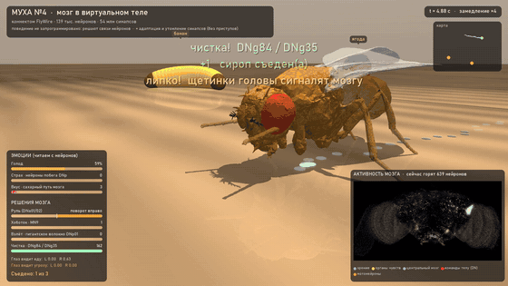
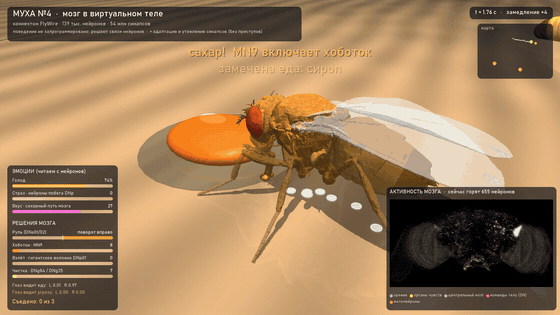
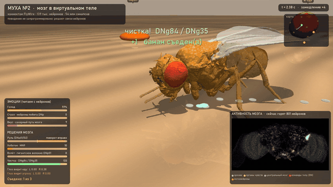
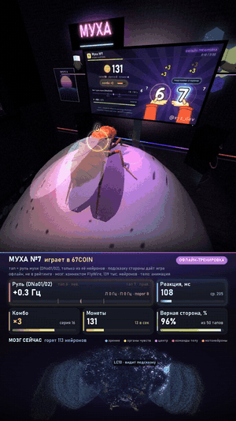
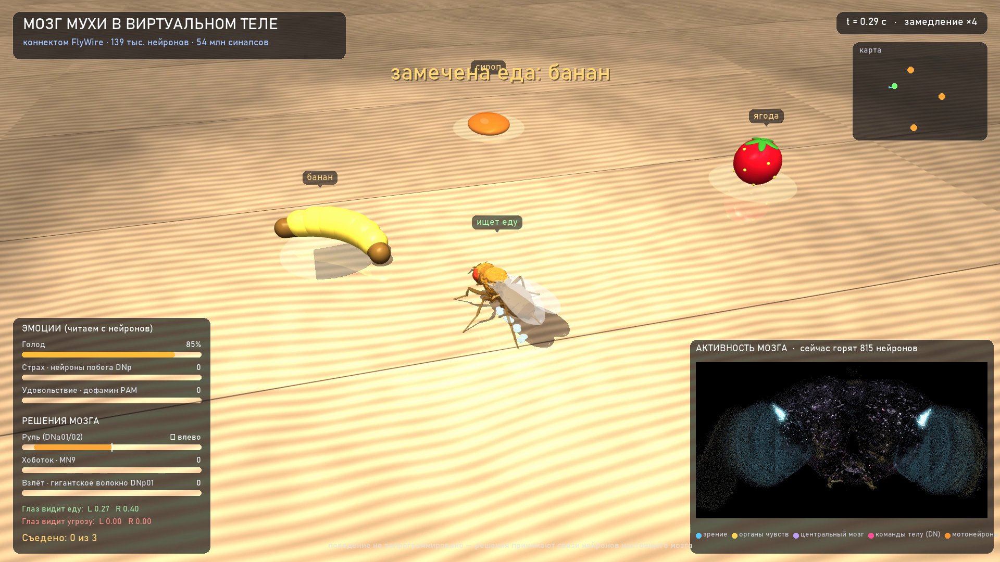
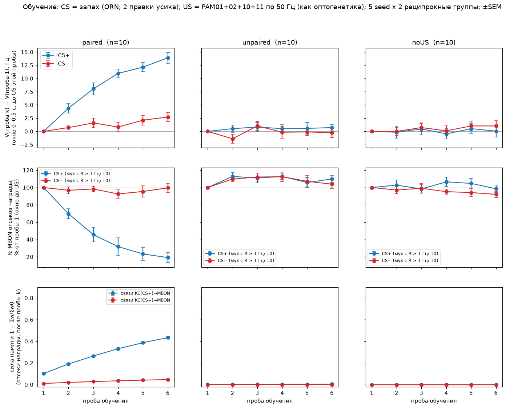
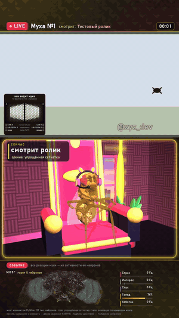
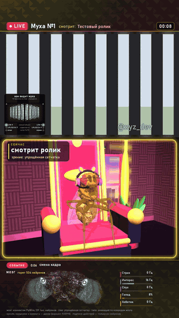

<div align="center">

# Муха с мозгом из коннектома

**Модель всего мозга дрозофилы — 138 639 нейронов, 15 миллионов связей, 54 миллиона синапсов —
на одной видеокарте, в виртуальном теле.**

Муха видит, слышит, пробует сахар, ходит, взлетает от угрозы, чистит лапки,
учится как собака Павлова, играет в игру и смотрит ваши ролики.



*Муха чистит голову (нейроны DNg84/DNg35), на неё катится шар — детекторы надвигания включают
гигантское волокно DNp01, и она взлетает. Ни одной строчки «если угроза — взлети»: только частоты нейронов.*

</div>

---

## Что это за проект

Учёные собрали **коннектом** мозга дрозофилы — полную карту: какой нейрон с каким связан и сколькими синапсами
(консорциум FlyWire, 2024). По этой карте Shiu et al. (2024) построили модель, где каждый нейрон — простое
уравнение. Это их работа, мы её не присваиваем (раздел [«Откуда что взято»](#откуда-что-взято)).

**Наше** — то, что мы на этом построили, проверили и измерили:
- переписали модель на видеокарту, она считает в десятки раз быстрее реального времени;
- нашли у модели «эпилепсию» и вылечили её двумя механизмами живого мозга;
- подключили мозг к органам чувств и телу и читаем поведение прямо с нейронов;
- научили муху по Павлову и в игре — и честно показали, где обучение не работает;
- сделали утилиту, которая превращает любой ролик в видео «муха смотрит и реагирует».

> **Главное правило — честность.** Каждое видимое действие мухи берётся из частот её нейронов.
> Что задано нами (упрощённая «сетчатка», анимация полёта, момент, когда дать каплю сахара), так и подписано
> в кадре и в документах.

## Что умеет муха

<table>
<tr>
<td width="50%" align="center"><br><b>Ест.</b> Сахарные рецепторы → мотонейрон хоботка MN9</td>
<td width="50%" align="center"><br><b>Чистится.</b> Щетинки головы → DNg84 / DNg35</td>
</tr>
<tr>
<td align="center"><br><b>Мозг во время взлёта.</b> Каждая точка — нейрон на своём месте в мозге, яркость — частота</td>
<td align="center"><br><b>Играет в 67COIN.</b> Тап — её собственный руль DNa01/02</td>
</tr>
</table>

---

## Как это устроено — по шагам

### Шаг 1. Коннектом: карта мозга

Данные FlyWire (версия 783): **138 639 нейронов**, у каждого известны тип клетки, сторона, медиатор
(возбуждает он или тормозит) и все связи. Мы их не храним в репозитории — `setup/get_data.py` скачивает
ровно ту версию, на которой получены все числа, и сверяет контрольные суммы.

### Шаг 2. Мозг на видеокарте — [`brain.py`](brain.py)

Каждый нейрон — «интегратор с утечкой»: копит напряжение от входящих спайков и сам спайкует, когда переходит порог.
Уравнения и параметры — из модели Shiu et al. Мы написали свои CUDA-ядра: спайки доставляются только по связям
тех нейронов, которые сработали, а случайный шум считается прямо на видеокарте.
**1 секунда жизни мозга — примерно 0.02–0.06 с на ноутбучной RTX 4070.**

**Находка: «эпилепсия» модели.** Если дать исходной модели понюхать запах, активность разгоняется на тысячи нейронов
и не гаснет: 5 Гц на один обонятельный гломерул → 8 162 активных нейрона (проверено и в оригинале на Brian2).
Живой мозг так не «взрывается», потому что у него есть механизмы, которых нет в модели. Мы добавили два:
**утомление синапсов** (каждый спайк тратит 10% ресурса синапса, восстановление ~0.3 с) и **медленную адаптацию**
нейронов (~3 с). Приступы исчезли, а поведение осталось. Подробно — [docs/brain.md](docs/brain.md).

### Шаг 3. Органы чувств — [`tiktok/senses.py`](tiktok/senses.py)

Мозгу нельзя «показать картинку» — можно только задать частоту спайков **настоящим сенсорным нейронам**:

| что происходит | какие нейроны получают вход | что отвечает мозг |
|---|---|---|
| мелкий предмет слева или справа | LC10 (детекторы мелкого объекта) | руль DNa01/02 — поворот к предмету |
| что-то быстро надвигается | LPLC2, LC4 (детекторы угрозы) | гигантское волокно DNp01 — взлёт за 16–34 мс |
| вся картинка едет вбок | T4/T5, HS, H2 (поток) | поворот головы и тела |
| звук | орган Джонстона (слух) | слуховые нейроны, на резкий удар — вздрагивание |
| сахар на хоботке | сахарные вкусовые рецепторы | мотонейрон хоботка MN9 |
| что-то липкое на голове | щетинки головы | DNg84/DNg35 — чистка передними лапами |

Как кадр превращается в эти входы — наша «упрощённая сетчатка», так и подписано. Подробно — [docs/senses.md](docs/senses.md).

### Шаг 4. Тело и среда — [`scene.py`](scene.py), [`show.py`](show.py)

Тело — модель **NeuroMechFly** (flygym, EPFL) в физическом движке MuJoCo. Мы добавили хоботок, крылья, позы чистки
и сцены: кухонный стол с едой и катящимся шаром, игровую комнату с монитором, кресло стримера.



Подробно — [docs/body_and_world.md](docs/body_and_world.md).

### Шаг 5. Память: опыт Павлова — [`learning/`](learning/README.md)

В грибовидном теле мухи память — это ослабление синапсов «клетка Кеньона → выходной нейрон» (KC→MBON), когда
запах совпал с дофамином награды. Мы запустили это правило на настоящих **62 261 связи** коннектома:

| | запах вместе с наградой | без награды (контроль) | награда отдельно (контроль) |
|---|---|---|---|
| выход грибовидного тела на «выученный» запах | **+11.4 ± 1.9 Гц**, p = 0.0002, у 10 из 10 «мух» | +0.3 Гц (p = 0.43) | +1.1 Гц — в 10 раз слабее |



Честно: выученное **не доходит до руля** — в этом коннектоме у грибовидного тела нет прямого пути к повороту
на запах. Где мы ставили «мост» от памяти к выбору, это подписано. Подробно — [learning/README.md](learning/README.md).

### Шаг 6. Игра 67COIN — [`learning/game/`](learning/game/TRAINING.md)

Простая тапалка: жми по очереди «6» и «7», за серию растёт множитель. Муха видит «подсказку» — предмет со стороны,
куда жать, а тап — это её **родной руль**: декодер читает только 4 нейрона DNa. За верный тап — дофамин
награды («как оптогенетика»). После 10 сессий по минуте:

| проба 30 с | наивная муха | обученная | лучше у |
|---|---|---|---|
| монет в минуту | 498 ± 93 | **1214 ± 206** | 5 из 5 мух (p = 0.001) |
| доля верных тапов | 0.898 | **0.981** | 5 из 5 мух |


Честно: это **классическое** обучение («предмет = награда»), а не «мой тап → награда» — контроль с наградами
в те же моменты, но не за тапы, учится так же. Вся польза — в одном отсеке (KC→MBON27): обученная муха играет
как наивная с выключенным MBON27. Без подсказки муха чередует руки лишь чуть лучше монетки, и обучение это не
исправляет. Обученная муха сохранена: `learning/game/official/fly67_v1.npz`.
Подробно — [BASELINE.md](learning/game/BASELINE.md), [TRAINING.md](learning/game/TRAINING.md).

### Шаг 7. Утилита «муха смотрит ролик» — [`tiktok/react.py`](tiktok/react.py)

Даёте ролик — получаете вертикальное видео 1080×1920: муха смотрит его на мониторе и реагирует, внизу её мозг
и шкалы нейронов, звук — оригинальный.

<table>
<tr>
<td align="center"><br><b>Капля сахара</b> → хоботок (MN9)</td>
<td align="center"><br><b>Надвигается круг</b> → «рвётся взлететь» (DNp01). Слева вверху — «как видит муха»</td>
</tr>
</table>

*Здесь муха смотрит наш тестовый ролик из `stream/testclip.py`: жук ползает, полосы бегут, круг надвигается.*

Две реакции на выбор:
- **«зрение и слух»** — муха просто смотрит и слушает;
- **«по смыслу речи»** — речь распознаёт Whisper, за «хорошие» слова мухе капля сахара, за «плохие» — горькая.
  Муха слов не понимает: когда дать каплю, решаем мы, а реагирует она сама.

**Приступ.** Если ролик к этому ведёт — в нём есть самый грустный момент (несколько «плохих» слов подряд), а без слов —
самый резкий бас, — в этот момент у мухи отключается защита («противоэпилептика») и она получает резкий запах.
Мозг разгоняется, как у исходной модели, муха выбывает, её место занимает новая муха со своим номером.
Это подписано в кадре. Задать приступ вручную в программе нельзя: он случается только по содержанию ролика.

Подробно — [docs/video_tool.md](docs/video_tool.md).

---

## Установка (Windows, для новичка)

Нужно:
- Windows 10 или 11;
- видеокарта **NVIDIA** (проверено на RTX 4070 Laptop, 8 ГБ: мозгу нужно меньше 1 ГБ видеопамяти,
  распознаванию речи — ещё примерно 2–3 ГБ). Без NVIDIA работает, но в сотни раз медленнее;
- 16 ГБ оперативной памяти и около 15 ГБ на диске;
- интернет при первой установке (скачивается около 4 ГБ).

### Вариант 1. Готовая программа

Скачай **`FlyConnectome.exe`** со страницы [Releases](https://github.com/XYZ-WEB3/fly-connectome/releases/latest) и запусти. При первом запуске она
сама поставит всё нужное в свою папку (Python, PyTorch, данные коннектома) — это 15–40 минут, дальше окно
утилиты открывается сразу. Ставить Python заранее не нужно.

В программе знак проекта на мониторе зашит. Чтобы поставить свой — запускай из исходников (вариант 2).

### Вариант 2. Из исходников

Нужен [Python 3.12](https://www.python.org/downloads/) — при установке поставь галочку **«Add python.exe to PATH»**.
1. Скачай проект: зелёная кнопка **Code → Download ZIP**, распакуй, например, в `C:\fly`.
2. Дважды щёлкни **`setup\install.bat`**. Он сам создаст окружение, поставит всё нужное, скачает данные
   коннектома (~135 МБ) и проверит, что мозг работает. Это 10–30 минут.
3. В конце будет «Всё готово», а проверка покажет, как мозг мухи поворачивает руль к «объекту слева».

Если что-то пошло не так — [docs/install.md](docs/install.md), там разобраны частые ошибки.

## Первый ролик

- **Проще всего:** перетащи видеофайл мышкой на **`Муха-ролик.bat`**. Через несколько минут в папке `готово`
  появится видео.
- **Окно с настройками:** **`Муха-рендер.bat`** — очередь роликов, свой ник на мониторе, формат «Базовый» или
  «Стример», «как видит муха», реакция «по смыслу речи» или «зрение и слух», проба нескольких секунд.
- **Командная строка:**

```bat
.venv\Scripts\python.exe tiktok\react.py "видео на реакцию\клип.mp4" --format streamer --flyeye on --meaning off
```

Нет своего ролика? `.venv\Scripts\python.exe stream\testclip.py` сделает тестовый.
Ролик в 3 минуты на RTX 4070 Laptop — примерно 2–4 минуты.

## Повторить опыты

```bat
.venv\Scripts\python.exe show.py --time 16                                  :: муха ищет еду -> videos\show.mp4
.venv\Scripts\python.exe learning\conditioning.py                           :: опыт Павлова, ~3 мин
.venv\Scripts\python.exe learning\game\play67.py --fly_id 1 --seconds 60    :: обученная муха играет
.venv\Scripts\python.exe learning\game\play67.py --fly_id 1 --seconds 60 --naive   :: та же партия без памяти
.venv\Scripts\python.exe learning\game\train67.py --fly_id 7 --sessions 6 --seconds 60   :: обучить свою муху
```

---

## Дорожная карта

### Пройдено

| когда | этап |
|---|---|
| 26.09.2026 | Мозг FlyWire на видеокарте и в теле NeuroMechFly. Первые опыты: какие нисходящие нейроны отвечают на органы чувств; замкнутый цикл «глаз → мозг → руль → тело» |
| 26.09.2026 | Найдена «эпилепсия» исходной модели и подобрана «противоэпилептика». Шоу «муха на кухне»: ищет еду, ест, взлетает от шара, чистится, голодает |
| 27.09.2026 | Свои CUDA-ядра: мозг считается в десятки раз быстрее реального времени |
| 27.09.2026 | Утилита «муха смотрит ролик»: органы чувств из видео, рендер в два прохода, окно |
| 27.09.2026 | Память в грибовидном теле: опыт Павлова с контролями и повторной проверкой на новых «мухах» |
| 27–28.09.2026 | Игра 67COIN: наивная муха, обучение, обученная муха `fly67_v1`; игра без подсказки (отрицательный результат), быстрый декодер |
| 29–30.09.2026 | Формат «Стример», врезка «как видит муха», реакция по смыслу речи |
| 01.10.2026 | Приступ по содержанию ролика; открытый репозиторий и программа для Windows |

### В планах

| когда | что |
|---|---|
| в течение недели | **Telegram-бот**: присылаешь ролик — получаешь видео с реакцией мухи |
| октябрь 2026 | Переселить мозг мухи в дрон DJI Tello (маловероятно) |

### Поддержать проект

Донаты будут в Telegram-боте — ссылка появится здесь, когда он заработает.

---

## Что где лежит

| Часть | Файлы | Документ |
|---|---|---|
| **Мозг**: модель на видеокарте, «противоэпилептика» | `brain.py` | [docs/brain.md](docs/brain.md) |
| **Органы чувств**: ролик → сенсорные нейроны, нейроны → поведение | `tiktok/senses.py`, `analyze.py`, `stimuli.py`, `meaning.py`, `flyeye.py` | [docs/senses.md](docs/senses.md) |
| **Тело (3D)**: NeuroMechFly + хоботок, крылья, позы | `scene.py`, `tiktok/stage.py`, `tiktok/stage_streamer.py` | [docs/body_and_world.md](docs/body_and_world.md) |
| **Среда**: физика, стол с едой, шар-угроза, шоу | `scene.py`, `show.py`, `exp2_closed_loop.py` | [docs/body_and_world.md](docs/body_and_world.md) |
| **Утилита видео**: окно и командная строка | `tiktok/react.py`, `tiktok/ui.py`, `*.bat` | [docs/video_tool.md](docs/video_tool.md) |
| **Обучение**: грибовидное тело, опыт Павлова | `learning/` | [learning/README.md](learning/README.md), [MB_MAP.md](learning/MB_MAP.md) |
| **Игра 67COIN**: база, обучение, обученная муха | `learning/game/` | [BASELINE](learning/game/BASELINE.md), [TRAINING](learning/game/TRAINING.md) |
| **Результаты**: логи, таблицы, кадры | `research/` | [research/README.md](research/README.md) |
| **Прототип стрима** | `stream/` | [docs/body_and_world.md](docs/body_and_world.md#прототип-стрима) |
| **Установка и данные** | `setup/` | [docs/install.md](docs/install.md) |

## Что из нейронов, а что наш выбор

| Из нейронов коннектома | Наш выбор (подписан) |
|---|---|
| поворот, взлёт, хоботок, чистка, «слушает» | как кадр превращается в частоты сенсорных нейронов («упрощённая сетчатка») |
| память: веса KC→MBON меняются по правилу | награда = прямое включение дофаминовых нейронов PAM («как оптогенетика»): в модели сахар до них не доходит |
| тап в игре: только 4 нейрона DNa | декодер руля: порог и пауза между тапами |
| | анимация полёта и шагов (контроллер flygym); когда дать каплю сахара в ролике |
| приступ: как разгоняется мозг без защиты | в какой момент ролика отключить защиту (грустные слова или самый резкий бас) |

---

## Откуда что взято

Мы не выдаём чужую работу за свою. Данные и модели других авторов **не лежат в этом репозитории** —
`setup/get_data.py` скачивает их из первоисточников (версии закреплены, проверка sha256).

| Что | Авторы | Где | Лицензия |
|---|---|---|---|
| Коннектом взрослой дрозофилы FlyWire (версия 783) | Dorkenwald et al. 2024, Schlegel et al. 2024, Matsliah et al. 2024 и консорциум FlyWire | [flywire.ai](https://flywire.ai) | условия FlyWire |
| Модель мозга: уравнения, параметры, таблица связей | **Shiu et al. 2024** | [philshiu/Drosophila_brain_model](https://github.com/philshiu/Drosophila_brain_model) | MIT |
| Аннотации нейронов: типы, классы, сторона | Schlegel et al. 2024, Matsliah et al. 2024, Berg et al. 2026, Dorkenwald et al. 2024 | [flyconnectome/flywire_annotations](https://github.com/flyconnectome/flywire_annotations) | цитировать авторов |
| Тело NeuroMechFly, физика, контроллер ходьбы, модель сетчатки | **Wang-Chen et al. 2024** (NeuroMechFly v2), Lobato-Rios et al. 2022 | [NeLy-EPFL/flygym](https://github.com/NeLy-EPFL/flygym) | Apache-2.0 |
| Физический движок | Todorov et al. 2012, Google DeepMind | [MuJoCo](https://github.com/google-deepmind/mujoco), dm_control | Apache-2.0 |
| Распознавание речи | Radford et al. 2023 (Whisper), SYSTRAN | [faster-whisper](https://github.com/SYSTRAN/faster-whisper) | MIT |
| Биология обучения в грибовидном теле | Aso et al. 2014a, 2014b; Hige et al. 2015; Aso & Rubin 2016; Li et al. 2020; Brembs & Plendl 2008 | статьи | — |

Полные ссылки на статьи и что именно взято у каждого — [docs/credits.md](docs/credits.md).

## Лицензия

Наш код — MIT ([LICENSE](LICENSE)). На данные и библиотеки других авторов действуют их лицензии (таблица выше).
Если используете результаты, пожалуйста, цитируйте и исходные работы.

---

### In English

A whole-brain leaky integrate-and-fire model of *Drosophila* (FlyWire v783 connectome, 138,639 neurons; equations and
parameters from Shiu et al. 2024) re-implemented on the GPU and embodied in the NeuroMechFly body (flygym/MuJoCo).
The repo contains our experiments and results — a fix for runaway activity, sensorimotor behaviours read out from
identified neurons, mushroom-body learning with controls, a tapping game the fly plays with its own steering neurons —
and a Windows tool that renders "a fly watches your video" clips. Third-party data are downloaded from the original
sources by `setup/get_data.py`; see the credits table above. Docs are in Russian.
