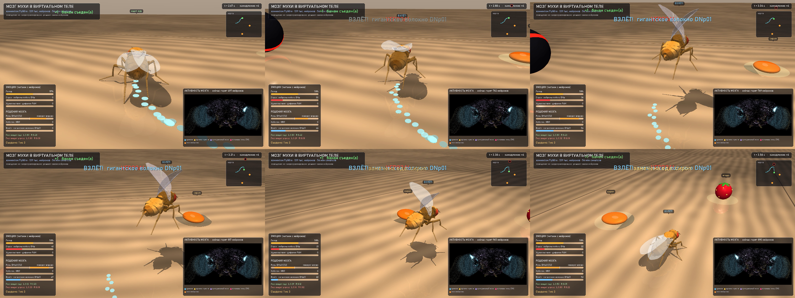

# Тело и  среда

## Тело: NeuroMechFly + наши суставы

Тело мухи — модель **NeuroMechFly v2** из библиотеки [flygym](https://github.com/NeLy-EPFL/flygym)
(Wang-Chen et al. 2024): 3D-сетка взрослой дрозофилы, суставы ног, физика MuJoCo, контроллер ходьбы
(генератор шага CPG + рефлексы), модель сложного глаза. Это **не наша работа** — мы ею пользуемся.

Что добавили мы (`scene.py`, `tiktok/stage.py`, `tiktok/stage_streamer.py`):
- **хоботок**: дополнительные суставы (rostrum, haustellum) и удлиняющие геометрии — выдвигается по частоте
  мотонейрона MN9 (`FlyPoser`, `scene.add_extra_joints`);
- **крылья**: раскрытие и взмахи при вздрагивании и взлёте (по гигантскому волокну DNp01);
- **чистка**: передние лапы тянутся к голове, пока горят DNg84/DNg35;
- **голова**: поворот по нейронам руля и потока;
- «кукольный» режим для роликов: физику не шагаем, позу ставим по командам мозга — так кадры можно рендерить
  параллельно (проход 2 в `tiktok/render_parallel.py`).

Что **не** из мозга, и это подписано: сам полёт — анимация (в этой физике нет аэродинамики), перевод команд
«поверни/иди» в движения ног — готовый контроллер flygym.

## Среда: стол на кухне (`scene.py`, `show.py`)

`KitchenArena` — арена MuJoCo: деревянный стол (текстура генерируется кодом), небо, свет с тенями,
еда (банан, капля сиропа, ягода), светящийся след мухи, «хищник» — тёмный шар, который катится на муху.
`CineCamera` — плавная камера, которая следует за мухой и меняет план на событиях.

`show.py` — шоу «мозг мухи в виртуальном теле»:

```
голодная муха видит еду -> поворачивает (DNa01/02) и идёт -> у еды сахарные рецепторы -> хоботок (MN9) -> ест
-> на неё катится шар -> детекторы надвигания LPLC2/LC4 -> гигантское волокно DNp01 -> взлёт -> посадка
-> липкая еда на голове -> щетинки -> DNg84/DNg35 -> чистка передними лапами
-> голод растёт (время ускорено); не поела — умирает; шар задавил — «лапками вверх», мозг гаснет
```

```bat
.venv\Scripts\python.exe show.py --time 16 --out videos\show.mp4
.venv\Scripts\python.exe show.py --silence DNa01 DNa02     :: «нейрохирургия»: выключить типы нейронов
```

Еда раскладывается случайно, но зерно мира = номер мухи, поэтому мир повторяем. Траектории всё равно различаются
от запуска к запуску — из-за шума Пуассона в мозге, это честное свойство модели.



### Опыты первых дней

| файл | что проверяет |
|---|---|
| `exp1_brain_only.py` | какие нисходящие нейроны (DN) отвечают на сенсорные входы — без тела ([results_exp1_dn.csv](../research/results/results_exp1_dn.csv)) |
| `exp2_closed_loop.py` | замкнутый цикл: глаз -> VPN -> мозг -> DNa01/02 руль, DNp09 «вперёд», MN9 — муха идёт к капле сахара |
| `scan_senses.py`, `scan_vpn.py` | какие сенсорные и зрительные группы что включают ([results_vpn_scan.csv](../research/results/results_vpn_scan.csv)) |
| `test_render.py` | рендер flygym работает |

### Подводные камни физики (пригодится, если будете делать свою арену)

- `BaseArena` во flygym по умолчанию ставит трение 100 — задайте своё `self.friction`.
- flygym считает **полом** все геометрии арены и добавляет им контакты с ногами. Декоративные объекты называйте
  с `sensor` в имени (так сделано в `scene.fx`).
- Физика — около 2 мс на шаг на процессоре, это самое медленное место в замкнутом цикле.
- `cv2.imwrite` на Windows не пишет в пути с кириллицей — используйте `cv2.imencode(...)[1].tofile(path)`.

## Сцены для роликов

- **Базовый** (`tiktok/stage.py`): муха привязана к шару (как в настоящих опытах с дрозофилой) в маленькой игровой
  комнате и смотрит ролик на мониторе. Ролик — текстура экрана внутри сцены, монитор поворачивается под ориентацию
  ролика. Камера сама подбирает план, чтобы муха и экран были в кадре.
- **Стример** (`tiktok/stage_streamer.py`, `tiktok/style.py`): муха в игровом кресле и наушниках, мульт-стиль.
  Комната (кресло, наушники, свет, стены, реквизит) задаётся номером варианта 0…999 999 — каждый ролик выглядит
  по-своему. Комната — косметика: на позу и подписи не влияет.

## Прототип стрима

`stream/` — ранний прототип формата «муха смотрит ролики в прямом эфире»: фон-сетап рендерится один раз
(5 с в цикле, `bg_loop.mp4`), ролик вклеивается в рамку монитора, муха — отдельный слой с прозрачностью,
сверху интерфейс. `stream/testclip.py` делает свой тестовый ролик без авторских прав
(жук ползает, полосы бегут, круг надвигается).

```bat
.venv\Scripts\python.exe stream\testclip.py
.venv\Scripts\python.exe stream\prototype.py --help
```
