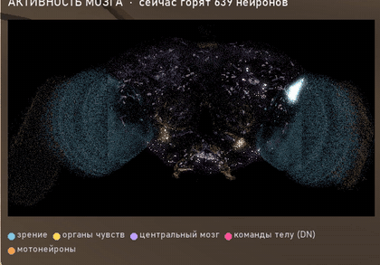

# Мозг: `brain.py`

<p align="center"></p>

*Активность мозга во время взлёта: каждая точка — нейрон на своём настоящем месте в мозге (координаты FlyWire,
вид спереди), яркость — частота спайков. Голубые «облака» по бокам — зрительные доли.*

## Что это

Модель всего центрального мозга взрослой дрозофилы: **138 639 нейронов, 15 091 983 связи, 54 492 922 синапса**
из коннектома FlyWire версии 783.

Уравнения и параметры — **один в один из Shiu et al. 2024** (исходная модель на Brian2 скачивается в `brain_model/`
скриптом `setup/get_data.py`). Мы переписали её на PyTorch и свои CUDA-ядра, чтобы мозг можно было крутить
шаг за шагом в замкнутом цикле с телом и роликом.

Каждый нейрон — интегратор с утечкой (LIF):

```
dv/dt = (v_0 − v + g − a) / t_mbr          мембрана; спайк при v > v_th, потом v = v_rst и рефрактерность t_rfc
dg/dt = −g / tau                            синаптический ток; спайк соседа j добавляет w_syn · (знак · число синапсов j→i)
вход органов чувств = пуассоновские спайки с частотой rate_in, каждый добавляет w_syn · f_poi
```

| параметр | значение | смысл |
|---|---|---|
| v_0 = v_rst | −52 мВ | покой и сброс |
| v_th | −45 мВ | порог спайка |
| t_mbr | 20 мс | постоянная мембраны |
| tau | 5 мс | затухание синаптического тока |
| t_rfc | 2.2 мс | рефрактерный период |
| t_dly | 1.8 мс | синаптическая задержка |
| w_syn | 0.275 мВ | вес одного синапса |
| dt | 0.1 мс | шаг счёта |

Знак синапса (возбуждающий или тормозный) задан медиатором пресинаптического нейрона — из таблицы Shiu et al.

## «Эпилепсия» и «противоэпилептика»

Исходная модель хорошо воспроизводит вкусовые и моторные пути, но **запах её «взрывает»**: вход в обонятельные
рецепторы разгоняет активность на тысячи нейронов, и она не гаснет после конца стимула.

Проверено и на оригинале (Brian2, `check_brian2.py`): 5 Гц на рецепторы одного гломерула DM1 в течение 300 мс →
**8 162 активных нейрона** ([research/results/check_brian2.log](../research/results/check_brian2.log)).
В нашей копии то же самое — значит, это свойство модели, а не ошибка переписывания.

В живом мозге так не бывает, потому что есть механизмы, которых в точечной LIF-модели нет. Мы добавили два:

| механизм | параметры | что делает |
|---|---|---|
| **утомление синапсов** (кратковременная депрессия) | `U = 0.1`, `tau_d = 300 мс` | каждый спайк тратит 10% ресурса исходящих синапсов, ресурс восстанавливается за ~300 мс; сенсорный вход не утомляется |
| **адаптация нейронов** | `a_inc = 0.1 мВ`, `tau_a = 3000 мс` | каждый спайк немного повышает тормозящий ток самого нейрона, ток спадает за ~3 с |

Подбор — `test_epilepsy.py`, `test_ae2.py`, `test_stability.py`, таблица
[research/results/results_epilepsy.csv](../research/results/results_epilepsy.csv). Критерий: приступа нет
(после стимула активность гаснет), а поведение осталось — хоботок на сахар, взлёт на надвигание, поворот к объекту.

Итог (везде дальше `PRM = dict(U=0.1, tau_d=300, a_inc=0.1, tau_a=3000)`):
- приступов нет ни от запаха, ни от смешанных стимулов: после стимула активность гаснет;
- хоботок (MN9) на сахар слабее, около 12 Гц, — муха ест «порциями»;
- взлёт (гигантское волокно DNp01) на надвигание около 100 Гц;
- руль к объекту — около 40% от исходного.

В утилите видео есть необязательный режим `--seizure`: в выбранный момент защиту выключают и дают резкий запах,
чтобы показать, как выглядит «приступ» исходной модели. Он подписан в кадре.

## Как считается быстро

Два пути с одной и той же математикой:

- **быстрый** (по умолчанию на NVIDIA): CUDA-ядро, которое компилируется при запуске через NVRTC
  (ставить ничего не нужно).
  - Один поток GPU — один нейрон, он сам делает до 18 шагов подряд.
  - Спайки не умножаются на всю матрицу связей, а «разбрасываются» только по исходящим синапсам тех нейронов,
    которые спайкнули (событийная доставка).
  - Пуассоновский вход — счётчиковый генератор Philox прямо в ядре.
  - Блок шагов записывается в CUDA Graph.
- **простой** (`FlyBrain(fast=False)`): обычные операции torch и разреженная матрица.

Быстрый путь повторяет простой **побитно** (тот же порядок операций в float32). На RTX 4070 Laptop одна секунда
жизни мозга считается примерно за 0.02 с — это в десятки раз быстрее реального времени.
Замеры — `bench_block.py`, `bench_graph.py`, `tiktok/bench_brain.py`.

## Как пользоваться

```python
import brain as B

PRM = dict(U=0.1, tau_d=300, a_inc=0.1, tau_a=3000)      # противоэпилептика
ann = B.load_annotations()                               # root_id -> тип клетки, класс, сторона, медиатор
b = B.FlyBrain(params=PRM, seed=0)                       # seed меняет только шум Пуассона
b.enable_graph()                                         # CUDA Graph: ещё быстрее

def cells(types, side=None):                             # индексы нейронов по типу клетки и стороне
    m = ann.cell_type.isin(types) & ((ann.side == side) if side else True)
    return [b.idx[r] for r in ann.index[m] if r in b.idx]

lc10_L = cells(["LC10a", "LC10c-1", "LC10c-2", "LC10d", "LC10e"], "left")   # детекторы мелкого объекта, левый глаз
b.set_input(lc10_L, 50.0)                                # «объект слева»: вход 50 Гц
hz = b.run(1000)                                         # 1000 мс -> спайков у каждого нейрона = частота, Гц
print("руль DNa слева/справа:", hz[cells(["DNa01", "DNa02"], "left")].mean(),
      hz[cells(["DNa01", "DNa02"], "right")].mean())
b.silence(lc10_L)                                        # «нейрохирургия»: спайки этих нейронов никуда не доходят
b.reset()                                                # мембраны, токи, адаптацию — в исходное состояние
```

- `b.ids` — FlyWire `root_id` каждого нейрона по индексу, `b.idx` — обратная таблица.
- `b.run(ms, tensor=True)` — результат остаётся на видеокарте (без копирования).
- Одинаковый прогон даёт только **новый** `FlyBrain` с тем же `seed`: `reset()` не сбрасывает генератор шума.

## Ограничения модели (важно для выводов)

- Нейрон — точка: нет дендритов, нет щелевых контактов, нет нейромодуляции.
- Дофамин в модели — быстрый **возбуждающий** синапс, хотя в мухе это модулятор. В опытах с обучением выход
  дофаминовых нейронов поэтому заглушён, а их спайки идут только в правило обучения ([learning/README.md](../learning/README.md)).
- Коннектом один (одна самка). Разные «мухи» у нас различаются только шумом.
- У коннектома есть своя асимметрия: одинаковые объекты с двух сторон дают руль влево сильнее, чем вправо.
  Это свойство данных, а не ошибка кода.
