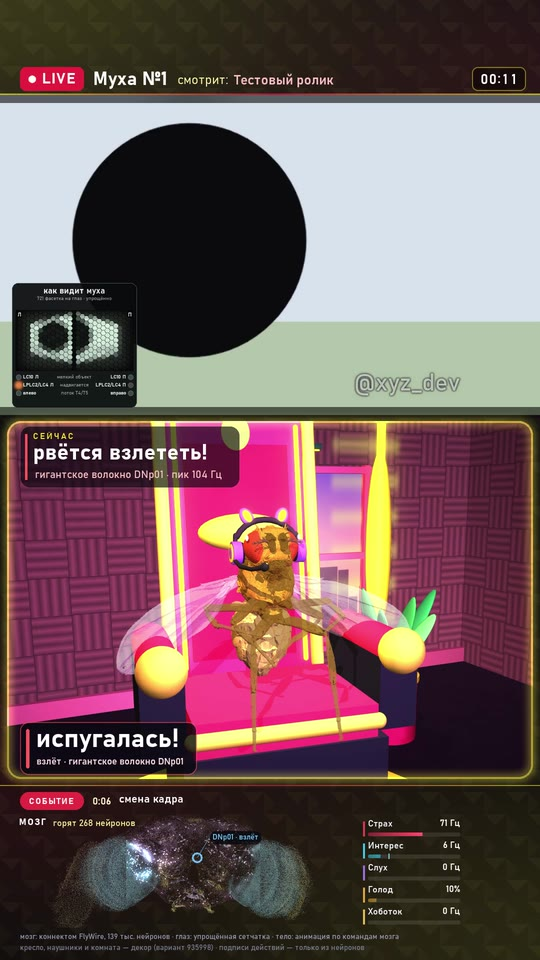

# Утилита «муха смотрит ролик»

Берёт ваш ролик и делает вертикальное видео 1080×1920 с оригинальным звуком:
- сверху муха смотрит ролик на мониторе в маленькой комнате;
- снизу её мозг (138 тысяч точек нейронов) и шкалы: страх, интерес, слух, голод, хоботок;
- подписи «сейчас: …» и бегущая строка событий.

Каждая реакция — по частотам её нейронов ([docs/senses.md](senses.md)).

<p align="center"></p>

*Кадр из ролика по нашему тестовому видео (`stream/testclip.py`): на мониторе надвигается чёрный круг,
детекторы угрозы LPLC2/LC4 включают гигантское волокно DNp01 — подпись «рвётся взлететь!». Слева вверху — врезка
«как видит муха» с лампами детекторов. Внизу — карта мозга и шкалы нейронов.*

## Три способа запустить

### 1. Перетащить файл
Перетащите видео мышкой на **`Муха-ролик.bat`** (из исходников). Формат «Стример», врезка «как видит муха», режим
«зрение и слух». Готовый ролик — в папке `готово`.

### 2. Окно — `Муха-рендер.bat`
- очередь из нескольких роликов, у каждого своё название (по умолчанию — имя файла);
- **вотермарка** (ник на мониторе в кадре; в программе `.exe` — зашитый знак проекта), качество, число процессов рендера;
- **формат**: «Базовый» (муха на шаре у монитора) или «Стример» (кресло, наушники, своя комната на каждый номер варианта);
- **«как видит муха»** — врезка с фасеточным зрением;
- **проба** — только N секунд ролика, чтобы быстро посмотреть;
- полоса прогресса и оценка оставшегося времени, «Стоп» останавливает всё.

Настройки запоминаются в `tiktok/ui_settings.json`.

**Приступ — только по содержанию ролика.** Если в ролике есть самый грустный момент (несколько «плохих» слов подряд),
а если слов нет — самый резкий бас, в этот момент у мухи отключается защита («противоэпилептика») и она получает
резкий запах. Мозг разгоняется, как у исходной модели, муха выбывает, её место занимает новая муха со своим номером.
В кадре это подписано («грустный момент: отключаем мухе защиту…»). Задать приступ вручную в окне нельзя.

Для исследователей в исходниках есть спрятанный блок: в `tiktok/ui.py` вверху `SHOW_SEIZURE = True` — появятся
выключатель «Приступ» и поле «на секундах»; в командной строке — ключ `--seizure` (ниже). В программе `.exe`
этого нет.

### 3. Командная строка — `tiktok/react.py`

```bat
.venv\Scripts\python.exe tiktok\react.py "путь\к\ролику.mp4" [ключи]
```

| ключ | что делает | по умолчанию |
|---|---|---|
| `--title "..."` | название в кадре | имя файла |
| `--watermark @ник` | знак на мониторе в кадре | `@xyz_web3` |
| `--format base\|streamer` | Базовый или Стример | `base` |
| `--variant N\|random` | комната Стримера (0…999 999) | `random` |
| `--flyeye on\|off` | врезка «как видит муха» | `off` |
| `--meaning on\|off` | «по смыслу речи» (Whisper -> сахар/горькое) или только зрение и слух | `on` |
| `--seizure auto\|off\|30,75` | приступ: по содержанию ролика / выкл / в эти секунды (для исследователей) | `auto` |
| `--secs N --t0 S` | проба: только N секунд, начиная с секунды S | весь ролик |
| `--crf 20..28` | качество: меньше — лучше и тяжелее | `24` |
| `--workers N` | процессов рендера (каждому ~1 ГБ памяти) | половина ядер, не больше 5 |
| `--out файл.mp4` | куда сохранить | `готово\муха_NNN_<имя>.mp4` |
| `--fly_no N` | номер мухи в кадре | следующий по счётчику `data/fly_counter.json` |
| `--lock метка` | ждать, если на машине уже идёт другой рендер | выкл |

Первый запуск с `--meaning on` скачает модель Whisper large-v3 (около 3 ГБ, один раз).

## Как это работает

1. **Проход 1** (последовательно, видеокарта): разбор ролика -> план стимулов -> органы чувств -> мозг ->
   команды телу -> поза «куклы» -> лог состояния по кадрам.
2. **Проход 2** (параллельно, процессор): 3D-сцена по логу в нескольких процессах, вёрстка 1080×1920,
   оригинальный звук, кодирование (h264 на видеокарте, если получится, иначе на процессоре).

Ролик в 3 минуты на RTX 4070 Laptop — примерно 2–4 минуты. Если не хватает памяти, уменьшите `--workers`.

## Что в кадре честно, а что оформление

- Поворот головы и тела, хоботок, взлёт, вздрагивание, чистка, «слушает», «следит» — из нейронов.
- Карта мозга внизу — настоящие координаты нейронов FlyWire, яркость точки — её частота.
- Шкалы «страх», «интерес», «слух», «хоботок» — частоты конкретных групп нейронов. «Голод» — правило игры.
- Комната, кресло, свет, камера, музыка ролика — оформление.
- Когда дать каплю сахара или горького — решаем мы, и в бегущей строке написано, за что
  (например, «капля сахара за бас-дроп» или «горькая капля: «ужас»»).

## Свои ролики и авторские права

Ролик, который вы даёте мухе, остаётся вашим или чужим — утилита ничего не меняет в правах на него.
Публикуйте только то, что вам можно публиковать.
