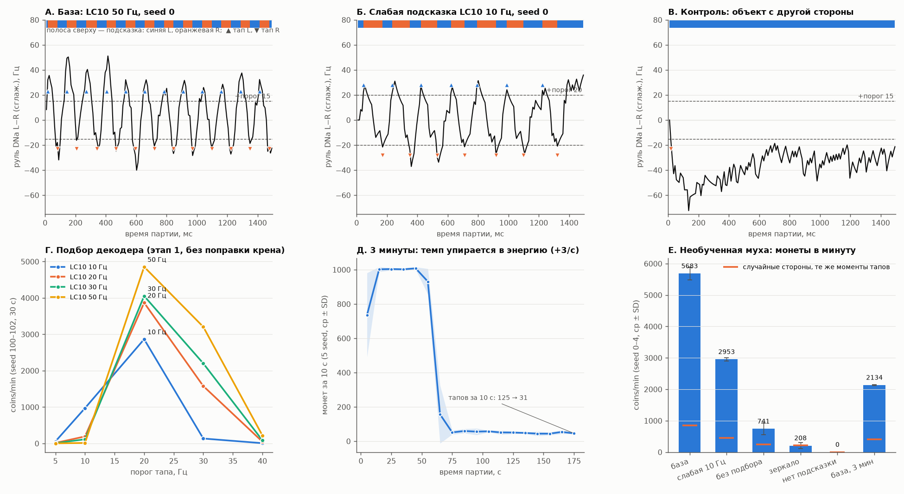

# 67COIN: необученная муха играет родным рулём (база, задача C)

Муха видит подсказку со стороны, куда надо тапнуть. Тап — это её **собственный руль**: DNa01+DNa02, левые минус
правые, сглаженные за 60 мс. Когда руль пересекает ±порог, это тап в ту сторону. Обучения и награды здесь нет.
Все числа измерены на мозге с PRM = dict(U=0.1, tau_d=300, a_inc=0.1, tau_a=3000).



## Главное

1. **Необученная муха уже играет почти идеально.** С подсказкой LC10 50 Гц она тапает в нужную сторону
   в 100% случаев (4 161 тап, 5 seed, ни одной ошибки). Серия не прерывается всю партию, множитель ×7.
   Результат — **5683 ± 200 coins/min, это 97.7% потолка правил** (5817 coins/min за 60 с).
   Это врождённый рефлекс «повернуть к мелкому объекту»: LC10 → DNa на той же стороне.
2. **При этой подсказке родное обучение ничего изменить не может.** Во время игры все 5 177 KC дают **0 спайков**,
   все 331 DAN и MBON26/27 тоже молчат. Готовность ê = 0, поэтому правило KC→MBON ничего не пишет. Проверено напрямую:
   - 60 с игры с наградой (PAM01/02/10/11 по 50 Гц, 845 наград, дофамин выше порога 58.8 с) и включённым обучением;
   - итог: max |w − w0| = **0**, журнал тапов **побитно совпал** с партией без награды.
3. **Запаса для улучшения почти нет.** Ошибок нет. Скорость упирается в рефрактерность декодера:
   медианное время реакции 63 мс — это 7 шагов по 9 мс при рефрактерности 60 мс. Остаток до потолка — 2.3%.
4. Честный вывод для «сначала научить, потом играть»: с подсказкой только через LC10 обучение в MB **не может**
   улучшить игру. Причины две: игра для наивной мухи слишком лёгкая, а KC подсказку не видят.
   Чтобы обучению было что делать, нужны оба условия:
   - подсказка, которая родным путём доходит до KC (VPN чашечки → KCg-d, задача B: `cues67.py`);
   - игра, в которой наивная муха ошибается (слабая LC10: по данным задачи B, ниже ~4 Гц R-метка часто не поворачивает).

## Установка

| | значение |
|---|---|
| подсказка | LC10 (LC10a/c-1/c-2/d/e, 361 L / 367 R нейрон) на стороне подсказки, Пуассон 50 Гц (`LC10Cue`) |
| сторона подсказки | противоположна последнему **засчитанному** тапу; первая — случайная (из seed партии) |
| шаг мозга | 9 мс (5 блоков по 1.8 мс); перед партией 500 мс разогрева без подсказки (не в счёт) |
| декодер | y = сглаженный (τ 60 мс) DNa01+02 L−R; тап L при y > +15 Гц, R при y < −15 Гц; снова взведён при \|y\| < 12 Гц; рефрактерность 60 мс; поправки крена нет |
| что видит декодер | только спайки 4 нейронов DNa. Подсказку и сторону своего прошлого тапа он не знает; триггер симметричен |
| счёт | журнал [[t_ms, 'L'\|'R'], ...] → `rules67.score_log` (правила — `rules67.py` рядом). Живой HUD (`Live67`) совпал с ним во всех 35 партиях и на 3000 случайных журналах (быстрые тапы, нет энергии, криты, улучшения) |
| подбор | 94 конфигурации на seed 100–102 по 30 с, критерий coins/min (`_scratch/tune.log`, `tune.csv`); оценка на **других** seed 0–4 по 60 с |

## Результаты (seed 0–4, 60 с, среднее ± SD)

| условие | тап/мин | верно: L / R | реакция, медиана L / R, мс | сбросов (та же рука) | сбросов паузой | best_combo | coins/min | случайные стороны* | энергия: потрачено / осталось | не хватило энергии |
|---|---|---|---|---|---|---|---|---|---|---|
| **база** (LC10 50 Гц) | 832 ± 28 | 1.000 / 1.000 | 63 / 72 | 0 | 0.6 ± 0.9 | 7 | **5683 ± 200** | 844 ± 28 | 832 / 13 | 1 ± 1 |
| база, выход DAN заглушен** | побитно = база | | | | | | 5683 ± 200 | | | |
| слабая подсказка LC10 10 Гц (порог 20) | 440 ± 8 | 1.000 / 1.000 | 94 ± 5 / 162 ± 9 | 0 | 0 | 7 | 2953 ± 55 | 447 ± 8 | 440 / 409 | 0 |
| без подбора (30 Гц, порог 15, перевзвод 7.5) | 237 ± 45 | 1.000 / 1.000 | 68 / 74 | 0 | 11.8 ± 0.8 | 7 | 741 ± 182 | 240 ± 45 | 237 / 601 | 0 |
| контроль: подсказки нет | 0 | — | — | 0 | 0 | 1 | 0 | 0 | 0 / 670 | 0 |
| контроль: объект с другой стороны | 208 ± 96 | 0.000 / 0.000 | — | 207 ± 96 | 0 | 1 | 208 ± 96 | 211 ± 97 | 208 / 611 | 0 |
| база, 3 минуты | 419 ± 3 | 1.000 / 1.000 | 63 / 72 | 0 | 34.6 ± 3.4 | 7 | 2134 ± 11 | 406 ± 2 | 1200 / 2 | 56 ± 4 |

\* Те же моменты тапов, но стороны случайные 50/50 (100 перемешиваний; `score_log`).
Идеальный игрок в тех же моментах (всегда в сторону подсказки) набирает **ровно столько же, сколько муха**, во всех условиях, кроме зеркала.

\** Выход DAN заглушён через `MBPlasticity` с `enabled=False`, как у будущей обучаемой мухи. Журналы совпали побитно: DAN во время игры молчат.

Потолок правил (строгое чередование, ровный темп, перебор темпа, `_scratch/c7_diag.log`):
- 60 с — 5817 coins/min (850 тапов = 670 + 3·60 энергии). Муха набирает 97.7% (от 91.6 до 99.6% по seed).
- 180 с — 2779 coins/min. Муха набирает 76.8%.

### Что ещё измерено

- **Врождённый левый крен виден во времени реакции**:
  - R медленнее L на 8.1 ± 3.0 мс (один шаг; p = 0.004, парный t, у 5/5);
  - при слабой подсказке — на 78 ± 7.5 мс (p = 2e-5, у 5/5).

  Ошибок стороны крен при этом не вызывает.
- **Без подсказки DNa молчат полностью** (0 Гц). Поэтому ложных тапов нет, а все тапы вызывает подсказка.
  Зеркальный контроль это подтверждает: 0% верных, серия ни разу не растёт.
- **Эпилепсии нет.** Активных нейронов за 9 мс в среднем 193, максимум 294 (за 3 мин — 350). Без подсказки — 0.
- **Узкая полоса перевзвода — ловушка декодера.** Сглаженный руль прыгает до 26–35 Гц за шаг, поэтому
  полосу ±7.5 Гц он иногда проскакивает. После этого декодер не взводится, пока муха держит поворот к объекту.
  В конфигурации «без подбора» все 12 пауз > 1.2 с из 12 — именно такие, отсюда 741 coins/min вместо 5683.
  Подобранный перевзвод ±12 Гц это убирает.
- **Длинная партия упирается в энергию**, и дальше включается та же ловушка. Тап без энергии не засчитан,
  поэтому подсказка не переключается, и муха продолжает поворачивать к тому же объекту. Декодер не взводится,
  пауза > 1.2 с сбрасывает серию.
  - В 3-минутной партии все 34 из 34 длинных пауз такие, из них 31 — сразу после тапа без энергии.
  - Средний множитель: 0–60 с — 6.85, после 60 с — 1.7–1.8.
  - Монет за 10 с: ~1000 → ~50.

  Идеальный игрок с ровным темпом на 3 мин набрал бы 2779 coins/min. Это проблема темпа и энергии,
  а не выбора стороны.
- **Проверка сантехники крючков** (не опыт!): подсказку подали ещё и прямо в 5% KC («как оптогенетика»),
  с наградой и обучением на 30 с.
  - Крючок пишет веса: память набора KC ≈ 0.9 в α1, β'2a, β1, γ5, γ5d.
  - Игра не изменилась: 864 против 870 тап/мин, верно 1.000 и там и там, потому что она уже на потолке.

## Как пользоваться

```python
import brain as B, senses as S, game67 as G       # sys.path: корень, learning/, learning/game/, tiktok/
ann = B.load_annotations(); b = B.FlyBrain(params=G.PRM, seed=0); b.enable_graph()
groups = S.build_groups(b, ann)
ses = G.Game67Session(seed=0)                     # подсказка, журнал, живой счёт (ses.hud() для HUD)
fly = G.FlyPlayer(b, groups, G.LC10Cue(b, groups, hz=50), threshold=15, refractory_ms=60, rearm=0.8,
                  reward=None,        # или dict(idx=pl.dan_indices(["PAM01",...]), hz=50, ms=300) — после ВЕРНОГО засчитанного тапа
                  plasticity=None)    # или MBPlasticity(b) — update() каждый шаг
fly.play(ses, 60_000)
res = ses.finish()                                # rules67.score_log + сверка с живым счётом (res["live_match"])
print(ses.summary(60_000))                        # тап/мин, верно по сторонам, реакция, сбросы, coins/min, энергия
G.reseed(b, 1)                                    # тот же мозг как новый FlyBrain(seed=1), побитно (c1_reseed_check.log)
```

`cue_fn` — любая функция `f(side)`, где `side` — `'L'`, `'R'` или `None`; она ставит входы в `b.rate_in`.
Метки задачи B подключаются так же.
Скорость: 60 с партии — около 1.5 с GPU (≈ 42× реального времени), вместе с чтением DNa на каждом шаге.

Запуск: `PYTHONIOENCODING=utf-8 .venv/Scripts/python.exe -W ignore learning/game/baseline.py --tune` (9 мин),
затем `--eval` (2 мин). Рисунок — `_scratch/c6_plot.py`.

## Файлы

- `game67.py`:
  - `Live67`, `Game67Session` — партия, подсказка, журнал, HUD, сверка;
  - `LC10Cue`, `FlyPlayer` — муха-игрок, крючки награды и пластичности;
  - `reseed`, `reference_scores`.
- `baseline.py` — подбор и оценка.
- `logs/baseline_<условие>_seed<k>.json` — 35 партий. В каждой: журнал, события тапов, смены подсказки,
  итог `score_log`, сводка; у base / weak10 / mirror ещё след руля за первые 10 с.
- `_scratch/`:
  - `c0` — HUD против rules67;
  - `c1` — reseed;
  - `c2` — руль от LC10;
  - `c3` — скорость;
  - `c4` — MB во время игры;
  - `c5` — крючки;
  - `c7` — потолок и ловушка декодера;
  - `c8` — таблицы по seed;
  - `tune.*`, `best_cfg.json`, `baseline_eval.*`.

## Ограничения

- Подсказка — упрощённая сетчатка: все LC10 одной стороны по 50 Гц. Это не настоящее изображение.
  Сила подсказки подобрана под лучшую игру наивной мухи.
- Подбор шёл на партиях по 30 с, где энергия не мешает. В 60 с она почти на пределе: потрачено 832 из 850.
- Декодер — наш выбор: порог, гистерезис, рефрактерность. Именно рефрактерность 60 мс, а не мозг,
  задаёт максимальный темп.
