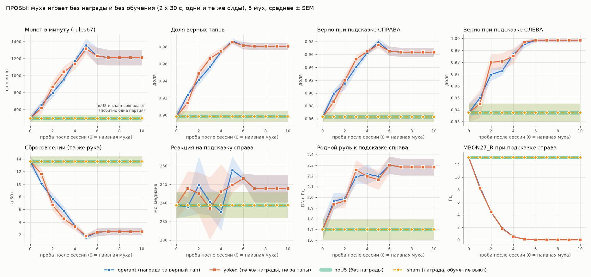
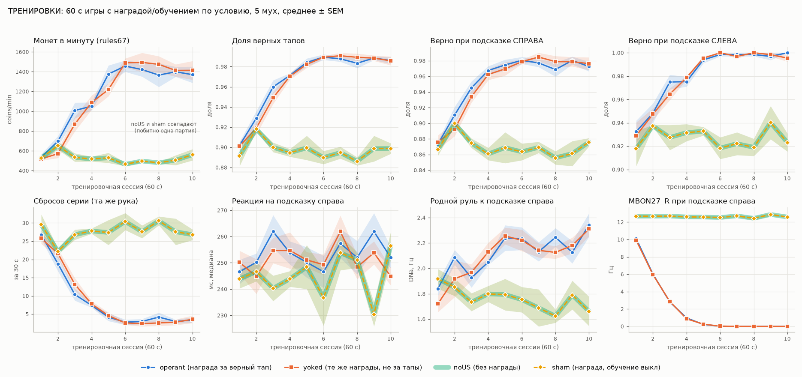
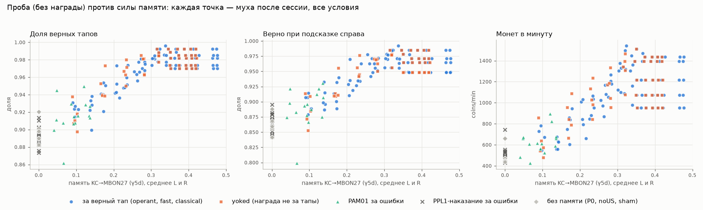
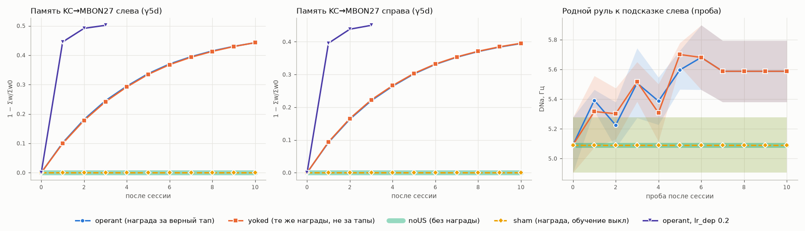

# 67COIN: сначала учим муху, потом она играет (задача D)

Муха видит подсказку со стороны, куда надо тапнуть. Тап — это её **родной руль**: DNa01+DNa02 слева минус справа.
За верный тап муха получает «награду»: включение дофаминовых нейронов PAM01, как при оптогенетике. Правило
MBPlasticity ослабляет синапсы KC→MBON, где активность клеток Кеньона совпала с дофамином.
Между сессиями память (веса) сохраняется в файл. После обучения муха играет на счёт без награды.

Всё измерено на мозге с PRM = dict(U=0.1, tau_d=300, a_inc=0.1, tau_a=3000) и заглушённым выходом DAN
(как в MBPlasticity). 5 мух (seed-слоты 0–4), 10 сессий по 60 с, контроли. Счёт — `rules67.score_log`
(только чтение). Живой счёт с ним совпал во всех партиях.

## Коротко

Проба — 2 × 30 с игры без награды и без обучения. Сиды шума у каждой мухи свои, но одни и те же во всех сессиях
и условиях. Поэтому разница проб — это только разница выученных весов. Везде среднее ± SD по 5 мухам, p — парный t-тест.

| проба (30 с) | наивная муха | после 10 сессий обучения | Δ, p, у скольких мух |
|---|---|---|---|
| **монет в минуту** (rules67) | 498 ± 93 | **1214 ± 206** | +716 ± 193, p = 0.0012, 5/5 |
| доля верных тапов | 0.898 ± 0.014 | **0.981 ± 0.009** | +0.082, p = 5e-5, 5/5 |
| верно при подсказке **справа** | 0.863 ± 0.017 | **0.964 ± 0.015** | +0.101, p = 1.5e-4, 5/5 |
| верно при подсказке слева | 0.937 ± 0.017 | 0.998 ± 0.003 | +0.061, p = 7e-4, 5/5 |
| сбросов серии (та же рука) за 30 с | 13.6 ± 1.8 | 2.5 ± 1.3 | −11.1, p = 3e-5, 5/5 |
| средний множитель | 1.84 | 4.52 | +2.68, p = 8e-4, 5/5 |
| best_combo | 5.0 | 6.9 | +1.9, p = 0.02, 4/5 |
| реакция (медиана) L / R, мс | 157 / 239 | 159 / 244 | не изменилась (p ≥ 0.46) |
| тапов в минуту | 271 | 269 | не изменилось (p = 0.69) |
| родной руль к подсказке справа (DNa, Гц) | 1.70 | 2.28 | +0.58, p = 1e-4, 5/5 |
| родной руль к подсказке слева (DNa, Гц) | 5.09 | 5.59 | +0.50, p = 0.036, 5/5 |
| MBON27_R при подсказке справа, Гц | 13.1 | **0.0** | p = 2e-7 |
| MBON27_L при подсказке слева, Гц | 23.0 | **0.0** | p = 5e-7 |

По мухам, монет в минуту: 469 → 953, 470 → 1072, 662 → 1393, 450 → 1215, 438 → 1436.

Итог честно:
1. **Родное обучение улучшает игру.** Ошибок стало меньше: 10% → 2%. Монет в 2.4 раза больше, у всех 5 мух.
   Мостов нет: декодер читает только 4 нейрона DNa, веса меняются только в KC→MBON.
2. **Работает один рычаг — KC→MBON27 (отсек γ5d, учитель PAM01).** Метка возбуждает KCg-d своей стороны,
   те возбуждают MBON27 той же стороны, а MBON27 толкает руль **от** метки. Награда ослабляет KC→MBON27:
   MBON27 на метку замолкает (13–23 → 0 Гц), и ложные толчки в чужую сторону исчезают.
   Разбор по весам ниже: вся польза — от памяти MBON27, от остальной памяти пользы 0.
3. **Это классическое обучение, а не оперантное.** MB запоминает «метка → награда», а не «мой тап → награда»:
   - контроль yoked (те же награды в те же моменты, но не за свои тапы) учится так же, разница кривых p ≥ 0.59;
   - награда **за ошибки** тоже учит играть лучше: 0.898 → 0.927, p = 0.025, 5/5.

   По литературе так и у живой мухи: MB нужен для «world-learning» (что предсказывает награду), а оперантное
   «self-learning» от MB не зависит (Brembs & Plendl 2008).
4. **Потолок — «MB не мешает».** Обучение убирает помеху, которую вносит сам MB. Муха, чей MB подсказку не видит
   (только LC10, нет KC-кода), с той же силой LC10 играет 1.000 верно и 1417 ± 93 coins/min. Обученная —
   0.981 и 1214 ± 206: по монетам разница не значима (p = 0.12), по доле верных — значима (p = 0.009).
   Сделать муху лучше, чем «без MB», родное обучение здесь не может.
   **Точнее (ревизия E, новые мухи):** обученная муха играет так же, как наивная с **заглушённым MBON27**:
   1318 против 1322 coins/min, верно 0.986 против 0.986 (p ≥ 0.21, у 3 из 5 мух партии совпали до монеты).
   То есть по действию на игру выученное = «выключить MBON27 на метку». До «MB не видит метку» (только LC10:
   1463, верно 1.000) она не дотягивает (p = 0.047 и 0.004).
5. **Трудность выбрана так, чтобы было чему учиться.** С лёгкой подсказкой (LC10 50 Гц, BASELINE.md) наивная
   муха уже играет 5683 coins/min, и учиться нечему. Наша подсказка слабее (LC10 4 Гц + VPN чашечки 150 Гц,
   задача B), поэтому и темп ниже: 270 тапов/мин против 830.



## Путь (всё родное, кроме подписанного)

```
предмет слева ─┬─ LC10_L (детекторы объектов) ───────────────────────────► DNa_L  (руль К метке)
               └─ VPN чашечки_L ─► KCg-d_L ─► MBON27_L (γ5d) ─────────────► DNa_R  (руль ОТ метки)
                                      ▲             ▲
                        след KC 1.5 с ┘             └─ PAM01 (награда за тап, «как оптогенетика»)
тап L/R = сглаженный (60 мс) DNa01+02 L−R пересёк ±8 Гц (триггер Шмитта, рефрактерность 100 мс)
```

Справа всё зеркально. KC→MBON27 строго своей стороны: 100% синапсов (задача A). Поэтому память слева чинит
подсказку слева, а память справа — подсказку справа (см. разбор C).

## Что биология и что наш выбор

| | родное / литература | наш выбор (модель) |
|---|---|---|
| подсказка | LC10 и 24 типа VPN дополнительной чашечки своей стороны — настоящие нейроны (`cues67.CueSet`, задача B) | частоты: LC10 = 0.4 × 10 Гц = 4 Гц, VPN чашечки = 150 Гц; все 24 типа VPN вместе — это «упрощённая сетчатка» |
| тап | руль DNa01+02 — родной выход (4 нейрона) | декодер `game67.FlyPlayer`: сглаживание 60 мс, порог ±8 Гц, перевзвод при \|y\| < 4 Гц, рефрактерность 100 мс. Подобран **только на наивных мухах** (seed 100–102, 36 вариантов, `_scratch/d1_pilot.log`) и дальше не менялся. Замечание: один спайк одного DNa за шаг 9 мс даёт скачок около 8 Гц, поэтому порог 3–8 Гц почти равен «первый спайк» |
| награда | PAM01 (γ5, γ5d, γ4γ5) — дофаминовые нейроны награды; γ5d (MBON27) учит только PAM01 | включение PAM01 обеих сторон 50 Гц на 100 мс после верного засчитанного тапа — **«как оптогенетика»**: в модели сахар до PAM не доходит |
| правило | совпадение KC + дофамин → депрессия KC→MBON (Hige 2015) | MBPlasticity как есть, но `lr_dep = 0.02` вместо 0.2. В игре около 255 наград в минуту, и при 0.2 память насыщается за первую минуту (`d1b_speed.log`). С 0.02 кривая растягивается на 4–6 сессий. **Конечный уровень тот же**: условие fast (0.2) за 3 сессии даёт ту же пробу побитно. Правило считается бинами по 18 мс, как `MBPlasticity.run` |
| дофамин как синапс | в мухе — модулятор | выход всех 331 DAN заглушен (артефакт модели Shiu), их спайки идут только в правило |
| отсек calyx | — | заморожен (`freeze_compartments`): VPN 150 Гц сами гонят PPL2 выше порога (задача B). В noUS память за 10 минут игры = 0.000 |
| мост память → поведение | не нужен | **нет**. Декодер не знает ни подсказку, ни память. Проверено побитно, см. «Носитель» |

## Программа обучения

1. **(Необязательно) классическое предобучение.** 12 пар на сторону: подсказка L или R 2 с, PAM01 на 0.5–1.5 с,
   тапов нет, руль не читается. Всего 24 с награды.
   - Память MBON27 L/R становится 0.15 / 0.13.
   - Проба: верно 0.898 → 0.924 (p = 0.04, 5/5), справа 0.863 → 0.906 (p = 0.019, 5/5), coins/min 498 → 611 (p = 0.049).
   - То есть одна классика, без единого тапа, уже улучшает игру. После неё operant выходит на плато на 1–2 сессии раньше:
     проба 0.981 уже после 3-й сессии, у чистого operant — после 5-й.
2. **Оперантные сессии по 60 с.** Награда за каждый верный засчитанный тап, около 255 наград за сессию
   (PAM включён 27.5 с из 60). После каждой сессии `save_memory` → `memory/fly_<id>.npz`.
3. **Плато — после 4–5 сессий.** Доля верных на пробах по точкам (0 = наивная, дальше после сессий 1–10):
   0.898, 0.924, 0.941, 0.956, 0.974, 0.987, 0.981, 0.981, … .
   Монет в минуту: 498, 657, 798, 956, 1175, 1358, 1229, 1214, … .

   Начиная с 6-й сессии проба не меняется: MBON27 на метку уже молчит (0 Гц), и дальнейшее ослабление KC→MBON27
   спайков не меняет, поэтому при тех же сидах партия повторяется побитно. Синапсы при этом **не** на полу w_min
   (ревизия E, `_scratch/e6_floor.log`): у мухи 1 после 10 сессий тронутые KCg-d→MBON27 своей стороны — медиана
   w/w0 0.165 (L) / 0.158 (R), на полу 0.10 — ни одного; память MBON27 растёт и дальше (0.398 → 0.442 за сессии 6–9),
   но на игру уже не влияет.
4. **Рекомендация:** 6 сессий по 60 с (или классика 12 пар + 4 сессии). Больше не нужно.
5. **Игра на счёт** (`play67.py`) — без награды и без обучения. Память во время игры не меняется.



## Контроли

Сравнение условий идёт по пробам: парный t по мухам, P0 у всех условий общая.
- «Кривая» = среднее проб после сессий 1–10.
- «Рано» = после сессий 1–3, до насыщения.

| условие | что это | память MBON27 L/R после 10 | проба после 10 | operant − условие (кривая) |
|---|---|---|---|---|
| **operant** | PAM01 за верный тап, обучение вкл | 0.442 / 0.395 | 1214 coins/min, верно 0.981 | — |
| yoked | обучение вкл; награды в моменты наград operant-мухи того же слота и сессии, не за свои тапы (шум тренировки свой) | 0.443 / 0.395 | **то же** (побитно: MBON27 на метку молчит) | coins −4 (p = 0.90), верно −0.001 (p = 0.73), R −0.000 (p = 0.92); рано: −40 (p = 0.64) |
| noUS | обучение вкл, наград нет | **0.000 / 0.000** | = наивная, побитно | +605 coins (p = 6e-4), верно +0.070 (p = 1.5e-4) |
| sham | PAM01 за верный тап, обучение **выкл** | 0.000 / 0.000 | = наивная, побитно | +605 (p = 6e-4) |

- **sham = noUS побитно**, во всех 10 тренировках у всех 5 мух. Сама стимуляция PAM на поведение не влияет:
  выход DAN заглушен, и путь «награда → руль» в обход весов отсутствует.
- **noUS за 10 минут игры не набрал памяти вообще.** Изменённых связей 0: самообучения от подсказки нет,
  отсек calyx заморожен.
- **yoked и operant совпадают.** Память по сессиям отличается в среднем на 0.002 (максимум 0.007).
  Тренировки тоже одинаковые: coins/min 535 → 1370 у operant и 518 → 1414 у yoked.

## Носитель выученного — только веса KC→MBON (`_scratch/d3_carrier.log`)

Память operant после 10 сессий, 5 мух:

- **A.** `reset_memory()` → проба **побитно** равна наивной (журналы тапов совпали).
  `load_memory()` → побитно равна выученной. Повторили reset и load — снова побитно. Всё совпадает с d2 (5/5).
- **B.** В весах ядра `b._wv` изменено 454–462 позиции, **из них вне KC→MBON — 0**: MBON27 около 257, MBON01 около 202.
  После reset изменено 0.
- **C. Разбор.** Только в пробах; Δ к наивной, 5 мух.

  | какую память оставили | coins/min | верно | верно L | верно R |
  |---|---|---|---|---|
  | вся | 1214 (+716, p = 0.001) | 0.981 | 0.998 | 0.964 |
  | только KC→MBON27 (обе стороны) | **то же побитно** | 0.981 | 0.998 | 0.964 |
  | только MBON27_L | 596 (+99, p = 0.14) | 0.918 | **0.998** (+0.061) | 0.850 (−0.013) |
  | только MBON27_R | 808 (+310, p = 0.004) | 0.949 | 0.931 (−0.006) | **0.968** (+0.105) |
  | всё, кроме MBON27 (γ5: MBON01 и др.) | = наивная побитно | 0.898 | 0.937 | 0.863 |

  Память MBON27 своей стороны чинит подсказку своей стороны. Так и предсказывает анатомия: KC→MBON27 ипсилатерально,
  MBON27 → DNa контралатерально.
- **D. Подсказка без KC-кода** (только LC10, VPN чашечки выключены). KCg-d молчат (0 Гц), и выученная память
  не меняет игру **ни на один тап** (побитно, 5/5): памяти нечего передавать.
- **E.** Новый объект мозга + `load_memory` → тот же журнал (побитно).
- **F.** Счётчики MBON/KC в плеере только читают: без них журнал тот же (побитно).

## Чему учится MB: связи «метка → награда», а не «мой тап → награда» (`d4_contingency.py`)

Правило 0.2, 3 сессии, 5 мух, пробы как выше.

| условие | стимуляций за сессию | память | верно | верно R | coins/min |
|---|---|---|---|---|---|
| наивная | — | 0 | 0.898 | 0.863 | 498 |
| PAM01 за **верный** тап (fast) | 257 | γ5d 0.493 | 0.981 (p = 5e-5) | 0.964 | 1214 (p = 0.001) |
| PAM01 за **ошибку** | 23 | γ5d 0.135 | **0.927** (+0.028, p = 0.025, 5/5) | 0.909 (p = 0.017) | 728 (+230, p = 0.015, 5/5) |
| наказание PPL1 (PPL101–103) за ошибку | 29 | γ1/γ2 0.01–0.03 | 0.889 (−0.009, p = 0.31) | 0.861 | 471 (−27, p = 0.43) |

- Если бы MB учился оперантно, награда за ошибку учила бы ошибаться. Вместо этого муха стала **реже** ошибаться,
  хотя получила в 11 раз меньше наград. Метка горит всегда, и любой дофамин на её фоне ослабляет KC→MBON27.
- Точки всех условий ложатся на одну кривую «память MBON27 → игра»: Спирмен r = 0.88, p = 1e-88, 265 точек
  (`_scratch/d2_memory_vs_play.png`). Игра зависит только от памяти, а не от того, за что давали дофамин.
- **Наказание за ошибки не помогает.** Оно сильно ослабляет MBON32_L на подсказку слева (10.4 → 3.3 Гц,
  p = 9e-6), но игра значимо не меняется. Тренд на подсказке слева в худшую сторону: 0.937 → 0.920, p = 0.086.
  Задача A предсказывала вред: MBON32_L тянет к метке слева. Не использовать.





## Как пользоваться

Из корня проекта:

```
# обучить муху 7: 10 сессий по 60 с (память -> learning/game/memory/fly_7.npz, история -> fly_7.json)
PYTHONIOENCODING=utf-8 .venv/Scripts/python.exe -W ignore learning/game/train67.py --fly_id 7 --sessions 10 --seconds 60
#   повторный запуск ПРОДОЛЖАЕТ с сохранённой памяти; --pretrain 12 — классика перед первой сессией;
#   --probe — проба после каждой сессии; --mode yoked|noUS|sham — контроли (yoked: --yoke_from <fly_id>)
# сыграть на счёт (без награды и обучения) -> журнал + счёт rules67 в learning/game/logs/play_fly7_seed<N>.json
PYTHONIOENCODING=utf-8 .venv/Scripts/python.exe -W ignore learning/game/play67.py --fly_id 7 --seconds 60
#   --naive — та же партия без памяти (сравнение); --seed N — своя партия
```

Проверено на мухе 1: 6 сессий, потом перезапуск процесса и ещё 4. Журналы тапов всех 10 сессий **побитно**
совпали с непрерывным прогоном того же слота в d2. Память совпала до 1e-9 (округление float32 w/w0 при сохранении).
Например, сессия 9: верно 0.980, 1164 coins/min, 249 наград, память 0.442 / 0.394.
Партия на счёт (seed 30100, 60 с):

| муха 1 | coins | верно (L / R) | сбросов | best_combo | тапов | реакция L / R |
|---|---|---|---|---|---|---|
| с памятью (`logs/play_fly1_seed30100.json`) | **1460** | 0.992 (1.000 / 0.985) | 2 | 7 | 260 | 162 / 234 мс |
| без памяти (`logs/play_fly1_naive_seed30100.json`) | 503 | 0.891 (0.939 / 0.848) | 29 | 6 | 276 | 162 / 252 мс |

Счёт в обоих файлах пересчитан заново через `rules67.score_log(log, seed)` и совпал.

JSON партии содержит:
- `log` — `[[t_ms, 'L'|'R'], ...]` и `seed`;
- `score` — итог `score_log` и `live_match`;
- `summary`;
- `memory_file` и `memory_sha256`;
- флаги `learning_during_game=false` и `reward_during_game=false`.

Время на GPU (RTX 4070 Laptop, общий с другими задачами): сессия 60 с с обучением — 3.3 с на свободном GPU
и до 15–20 с на загруженном; проба 30 с — 2–4 с.

API для своего цикла:

```python
import train67 as T
rig = T.Rig()                                        # мозг + MBPlasticity (DAN заглушены) + CueSet + calyx заморожен
rig.pl.load_memory("learning/game/memory/fly_7.npz") # память мухи
ses, fly, sm = rig.play(seed, 60000, mode="operant", learn=True)   # сессия с наградой и обучением
rig.pl.save_memory("learning/game/memory/fly_7.npz")
ses, fly, sm = rig.play(seed, 60000)                 # игра без награды и обучения; ses.log -> rules67
```

## Ограничения

- **Муха одна и та же.** Коннектом один; «мухи» различаются только шумом (seed). Реакция мух похожа,
  поэтому SD малы. n = 5 на условие.
- **Числа подсказки и декодера — наш выбор.**
  - Декодер подобран на наивных мухах на трёх seed по 30 с. Разброс там большой: ±100–200 coins/min.
  - Сила подсказки 0.4 взята из задачи B заранее.
- **Скорость правила (0.02) и длина награды (100 мс) выбраны.** Они задают только число сессий до плато.
  Конечный уровень от них не зависит: он задан порогом — MBON27 на метку замолкает (0 Гц), дальше веса ещё
  падают, но спайков это не меняет. Проверено при 0.02 и 0.2 (память разная: 0.44 и 0.50, проба одна и та же побитно).
- **После насыщения пробы детерминированы.** Когда MBON27 молчит, при тех же сидах партия та же, поэтому хвост
  кривой плоский (это не «пол w_min»: у мухи 1 синапсы кода метки на ~0.16·w0, пол 0.10·w0).
- **Обучение не оперантное** (см. выше). Для игры это значит: память растёт от любой награды на фоне подсказки.
  «Учить за верные тапы» работает не потому, что муха связывает награду со своим действием.
- **Знак руля обучение не переворачивает.** Оно только убирает толчок «от метки». Потолок — наивная муха
  с заглушённым MBON27 (ревизия E: совпадает с обученной); муха без KC-кода (только LC10) играет ещё чуть лучше.
- **Забывания нет** (`tau_rec` выключен). Память хранится, пока её не сбросят.
- Все прежние ограничения MBPlasticity (README.md) остаются в силе.

## Ревизия E: повтор на новых мухах и новых сидах

Повторная проверка по коду тренера. Мухи 41–45: сиды тренировок новые, сиды проб 60000 + 100·f + j
тренер не видел. 6 сессий × 60 с (рекомендованная программа), пробы 2 × 30 с без награды и обучения, парный t по 5 мухам
(`_scratch/e2_newflies.py`, `e5_analyze.log`, `e3_robust.py`, `e7_robust_analyze.log`, `e1_integrity.log`, `e4_cli.log`,
`e6_floor.log`).

| проверка | результат |
|---|---|
| наивная → после 6 сессий | coins/min 492 ± 59 → **1318 ± 104** (p = 4e-5, 5/5); верно 0.890 → 0.986 (p = 1e-4); R 0.856 → 0.973; сбросов за 30 с 15.1 → 1.7; MBON27 на метку 13–23 → 0 Гц |
| уже после 2 сессий | 492 → 725 (p = 0.002, 5/5); верно 0.890 → 0.935 (p = 0.016) |
| operant против **yoked** | после 2 сессий +10 coins/min (p = 0.91), верно +0.003 (p = 0.74); после 6 — проба побитно та же у 4 из 5 мух (−17, p = 0.37); память отличается в среднем на 0.003 |
| operant против noUS / sham / **US без CS** | +826 coins/min (p = 4e-5) против каждого. У всех трёх память 0.000, изменено 0 связей, проба = наивная побитно. US без CS: 243 награды за сессию, но в тренировке VPN чашечки выключены (нет KC-кода) — памяти нет: нужна пара «метка + дофамин» |
| sham = noUS | тренировки побитно одинаковые во всех 30 сессиях: сама стимуляция PAM01 на поведение не влияет |
| другой декодер (топ-2..4 наивного подбора) | 664 → 1614, 437 → 1006, 430 → 1061 coins/min (p ≤ 0.002, 5/5 у каждого) — выигрыш не артефакт декодера |
| другая сила метки (память от 0.4) | 0.3: 232 → 499 (p = 0.007), верно 0.745 → 0.951; **0.5: 1329 → 1859 (p = 0.023, 5/5)** — выигрыш есть и при 0.5 (прогноз «при 0.5 учиться нечему» из прокси задачи B для этого декодера неверен) |
| метка без KC-кода (только LC10) | наивная = обученная побитно (1463, верно 1.000): память действует только через KC-код метки |
| нокаут MBON27 у наивной | **= обученная**: 1322 против 1318 coins/min, верно 0.986 против 0.986 (p ≥ 0.21) |
| зеркало (метка на другой стороне) | верно 0.004–0.037 у наивных и обученных: тап ведёт стимул через мозг, декодер стороны подсказки не знает |
| без метки | 0 тапов (наивная и обученная) |
| reset / load | reset → наивная побитно, load → выученная побитно, 5/5 |
| счёт | 290 партий ревизии + 240 журналов тренировок d2 + оба JSON мухи 1 пересчитаны `rules67.score_log` — расхождений 0; play67 повторяет партию seed 30100 побитно (1460 и 503) |
| brain.py по умолчанию | новый FlyBrain без пластичности: база задачи C (LC10 50 Гц, seed 0) = 5789 монет, 846 тапов, как в `baseline_eval.csv`; MBPlasticity + память + `detach()` → 0 изменённых весов, 0 заглушённых, та же партия побитно |
| CLI на новой мухе 47 | 4 сессии + перезапуск + 2 с `--probe`: проба 0.989 верно, 1300 coins/min; play67 seed 77777: 1470 (с памятью) против 591 (`--naive`) |
| эпилепсия | максимум 348 активных нейронов за шаг 9 мс из 138 639 |

Поправки после ревизии:
- «Плато = пол w_min» — неверно, исправлено выше: плато = MBON27 на метку замолчал; синапсы у мухи 1 на ~0.16·w0.
- Тапов в минуту на новых мухах чуть меньше: 279 → 267 (p = 0.013); у тренера разница была незначима. Это мелочь.
- Кодов ошибок в `learning/game/*.py` не найдено; декодер читает только 4 нейрона DNa (код и зеркальный контроль).

**Вердикт ревизии.** Сказать «муха научилась» можно, если сказать, чему именно. Она выучила по Павлову:
«этот предмет (зрительный код KCg-d своей стороны) = дофамин PAM01». Память — ослабленные KCg-d→MBON27 (γ5d).
MBON27 перестал отвечать на метку, его толчок «от метки» пропал, и родной рефлекс LC10 «к предмету» срабатывает
надёжнее. Она **не** выучила правило игры (чередование задаёт сама подсказка) и **не** связала «мой верный тап →
награда»: yoked учится так же. По действию на игру выученное равно нокауту MBON27.

## Файлы

- `train67.py` — обвязка и CLI обучения:
  - `Rig`, `Player` (режимы награды operant / yoked / wrong), `classical`, `probe`;
  - константы `CUE`, `DEC`, `REWARD`, `PLAST`.
- `play67.py` — игра на счёт с памятью → JSON партии.
- `memory/fly_1.npz`, `memory/fly_1.json` — обученная муха 1 (10 сессий) и её история.
- `logs/play_fly1_seed30100.json`, `logs/play_fly1_naive_seed30100.json` — партии.
- `_scratch/`:
  - `d0_smoke.py` — проверка обвязки;
  - `d1_pilot.py` / `.log`, `d1_tune.csv`, `d1_best_dec.json` — подбор декодера, потолок, скорость правила;
  - `d1b_speed.py` / `.log` — скорость по сессиям;
  - `d2_curriculum.py`, `d2_run_a.log`, `d2_run_b.log`, `d2_slot*.pkl`, `d2_mem/` — главный опыт
    (запуск: `d2_curriculum.py 0 1 2` и `3 4` параллельно, около часа на общем GPU);
  - `d2_analyze.py` / `.log` — таблицы и рисунки `d2_curves_probe.png`, `d2_curves_train.png`, `d2_memory.png`,
    `d2_memory_vs_play.png`;
  - `d3_carrier.py` / `.log` / `.pkl`, `d3b_lc10_compare.log` — носитель: веса, разбор, подсказка без KC;
  - `d4_contingency.py` / `.log` / `_*.pkl` — награда за ошибки, наказание;
  - `d5_cli_*.log` — проверка CLI;
  - ревизия E: `e1_integrity.py` / `.log` (счёт, brain.py, повтор play67), `e2_newflies.py`, `e2_run_*.log`,
    `e2_fly*.pkl`, `e2_mem/` (новые мухи и контроли), `e3_robust.py` / `.log` / `.pkl` (декодеры, сила, нокаут MBON27),
    `e4_cli.log`, `e4_mem/` (CLI на мухе 47), `e5_analyze.py` / `.log`, `e6_floor.py` / `.log`, `e7_robust_analyze.py` / `.log`.
